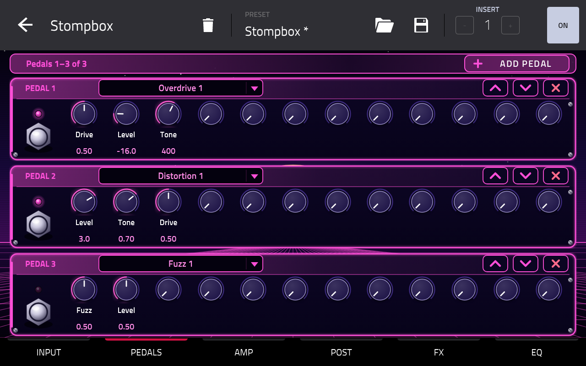
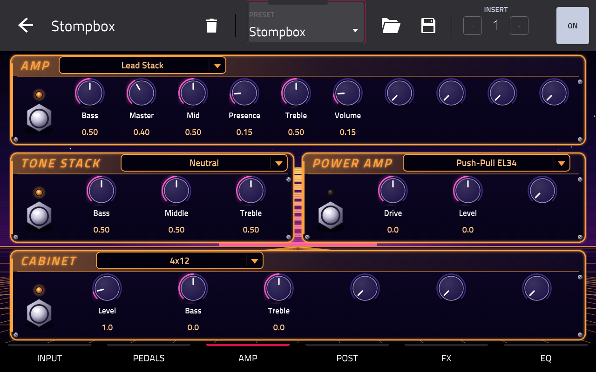
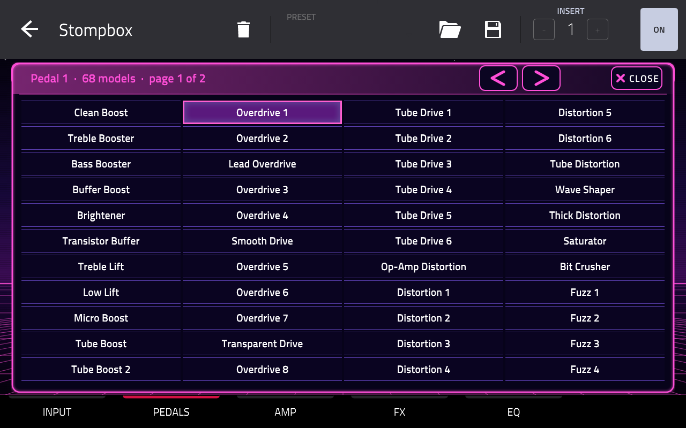
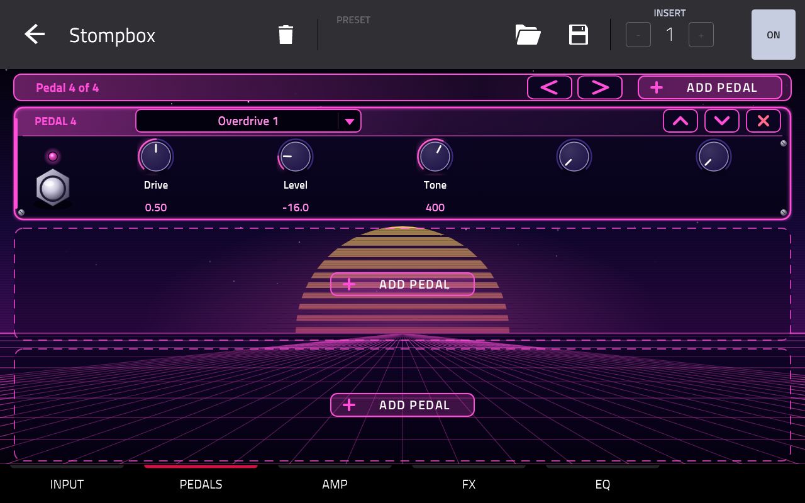
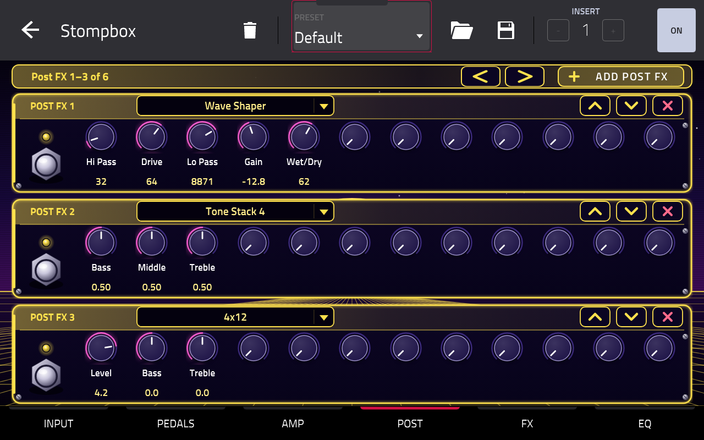
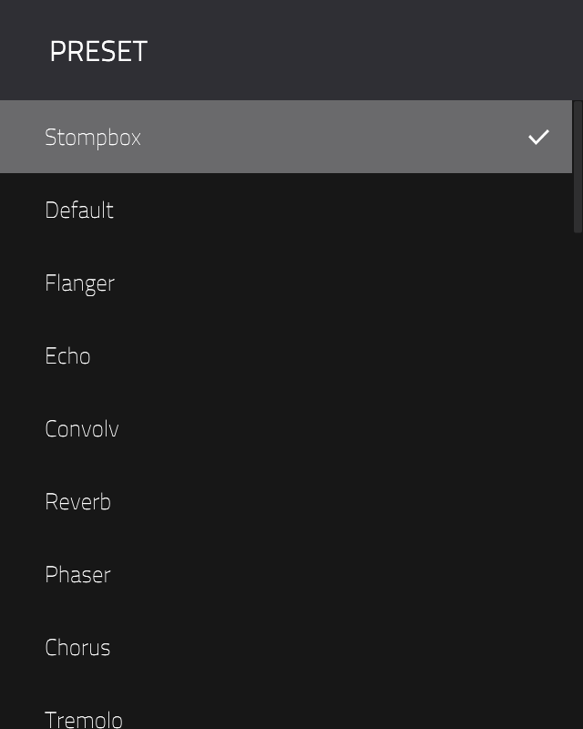

# Stompbox

> [!WARNING]
> **This is not a guitarix project.** I'm not affiliated with the guitarix developers, and they have nothing to do
> with this port. Stompbox was built with AI ([Claude Code](https://claude.ai/code)). If something goes wrong while
> you're using it, please **don't report it to guitarix**. Open an issue
> [here](https://github.com/jacob-sabella/mpc-vst-stompbox/issues) instead.

A full guitar rig for the Akai MPC, in one insert effect.

Plug a guitar into your MPC, put Stompbox on the track, and you get a pedalboard, an amp, a cabinet and a rack of
effects, all on the MPC's own touchscreen with Q-Links. It runs on MPC OS standalone devices (MPC Live, One, X, Key and
Force), Gen1 and Gen2.

The sound comes from [guitarix](https://github.com/brummer10/guitarix), the open-source Linux amp simulator, and from
its sister project [GxPlugins.lv2](https://github.com/brummer10/GxPlugins.lv2). Stompbox brings 219 of their models to
the MPC, along with guitarix's 40 factory presets.



## The rig

Your signal runs left to right through these slots:

```
input → gate → comp → wah → pedals → amp → tone stack → power amp → cabinet → post FX → mod → delay → reverb → EQ
```

Everything up to the post FX is mono. The last four slots are stereo.

| Slot | What you can pick |
|---|---|
| Gate | 2 noise gates |
| Comp | 5: compressor, multiband, expander, sustainer, swell |
| Wah | 15: wahs, an auto wah, an envelope filter |
| Pedals | as many as you like (up to 64), each one any of the 219 models. 71 of them are pedals: boosts, overdrives, distortions and fuzzes |
| Amp | 27: tube preamps, stacks, combos and bass amps |
| Tone stack | 27 |
| Power amp | 16 power amps and preamp impulse responses |
| Cabinet | 19 cabinets, plus an IR loader with guitarix's 91 impulse responses |
| Post FX | as many as you like (up to 64), each one any of the 219 models |
| Mod | 14: chorus, flanger, phaser, vibe (stereo and mono), tremolo, widener and more |
| Delay | 8 |
| Reverb | 4 |
| EQ | 11 |

The four stereo slots aren't fixed to their names. Each one takes any mod, delay, reverb or EQ model, so you can put
the reverb before the delay, or run two delays.

## Using it

Put Stompbox on a track's insert (channel mixer > EFFECTS). The skin has six pages, each with 16 Q-Links:

| Page | Slots |
|---|---|
| INPUT | gate, comp, wah |
| PEDALS | your pedals, three to a page |
| AMP | amp, tone stack, power amp, cabinet |
| POST | your post FX, three to a page |
| FX | mod, delay, reverb |
| EQ | EQ |

Every slot works the same way. It has a footswitch to turn it on and off, a model picker, and up to 12 knobs. The knobs
change with the model: a fuzz shows Fuzz and Level, a delay shows Feedback, BPM, Notes and so on. The first knob of
each slot sits on the first Q-Links of its page.



Tap a model name to open the browser. It shows 44 models a page, with the current one lit and arrows to page through
the rest. Tap a name to pick it, or CLOSE to leave things as they were. Each model remembers its settings while you try
others, and the project saves all of them. Switching models or footswitches fades over 5 ms, so there's no click.



### Pedals

A new rig starts with three pedals, all switched off. ADD PEDAL puts a new one at the end of the chain and turns to
its page. The arrows in a pedal's header move it earlier or later in the chain, and the X removes it. Moving a pedal
that's switched on can click, because the signal path changes at once.

A pedal only uses CPU while it's on, so it costs nothing to keep a few spare ones around.



### Post FX

The POST page works just like PEDALS, for effects after the cabinet: a fuzz after the amp, a second EQ, another
impulse response, anything from any section. It starts empty.



## Presets

Open the PRESET menu at the top of the plugin. The first entry, Stompbox, is the plain starting rig: a gate, the Lead
Stack amp, a tone stack and a 4x12 cabinet. After it come guitarix's 40 factory presets. Those are guitarix's own, plus
the banks from HarryVH, Musiclab and Sonnie Tele:

- **Effect demos:** Default, Flanger, Echo, Convolv, Reverb, Phaser, Chorus, Tremolo, Vibe, Solo Lead, Distort Lead
  and a few more
- **Song tones:** acoustic, bass, clean, crunch, distortion, FX and lead sounds, from Angie and Iron Man to Still Got
  The Blues
- **Everyday rigs:** finger bass, clean delay chorus, crunch picking and others



Picking a preset replaces the whole rig, so save your project first if you want to keep your edits. The old rig keeps
playing while the new one loads, then the sound changes over with no dropout. That takes under a second even for the
heaviest preset.

Preset names stop at 24 characters (the VST2 limit), so a few of the longer song names are cut short in the menu.

The presets aren't stored in this repo. The build converts them from guitarix's own files with `tools/gx_bank.py`.
guitarix lets you chain its units in any order, so the converter places each one in the matching Stompbox slot.
Anything that doesn't fit there goes to post FX.

If you use guitarix on a computer, your own banks live in `~/.config/guitarix/banks/`. Run
`tools/gx_bank.py <bank.gx>` to see what each preset in a bank would become in Stompbox. Loading your own banks on the
MPC isn't possible yet.

## Good to know

- MPC doesn't run a drum pad's insert while that pad is silent. On a silent pad, the browser, ADD PEDAL and the pedal
  arrows don't redraw the page until the pad plays. Put Stompbox on a track instead (seen on a Key 37, 2026-10-25).
- Model names are generic: "Overdrive 1", "Lead Stack", "4x12 Closed". The IR loader's impulse responses are
  "Amp 1" to "Amp 20", "Band 1" to "Band 70" and "Hall".

## Installing

There's no release yet. Once there is, it will be in the
[MPC plugin catalog](https://sd88me.github.io/mpc-vst-plugins/) and on this repo's Releases page. Until then, build it
yourself (below) and install it like any other plugin from
[mpc-vst-plugins](https://github.com/sd88me/mpc-vst-plugins).

## CPU

Measured on an MPC Key 37 (Gen1, RK3288) with MPC running. The figures are a percentage of the time MPC allows for one
128-frame block, so 100% is the limit (2026-10-24):

| Rig | mean | p99 | worst block |
|---|---|---|---|
| Starting rig: gate, Lead Stack, tone stack, 4x12 | 11.6 | 12.1 | 21.7 |
| Full: every slot but pedal 3, everyday models | 30.2 | 31.3 | 41.8 |
| Heavy: every slot on with its heaviest model | 73.9 | 75.4 | 87.0 |
| Convolv, the heaviest factory preset (2026-10-25) | 32.5 | 36.3 | 54.9 |

The tube preamp models ("12AX7", "6V6" and their push-pull and feedback versions) are the expensive ones, at about
14-20% each. The stacks and combos cost 2-7%, and the cabinet 3.4%. Models load on a background thread, so switching a
model never stalls the audio.

The standard release bench (mpc-vst-plugins' `tools/bench.sh`, result in `vst/bench.txt`) gives the starting rig a
**WARN**: 13.5% at p99 while it plays, rising to 21.3% while every Q-Link is swept at once, because a switched model
runs alongside the old one for its 5 ms fade (worst block 38.2%, 2026-10-25). Plan on one or two Stompbox instances in
a project, not several.

## How it's built

This repo contains **none of guitarix's or GxPlugins' code**. `upstream.env` pins one commit of each, and the build
fetches them with `tools/fetch-upstream.sh` and checks them by hash. guitarix's modules compile unchanged. What lives
here is the glue that turns them into an MPC plugin:

- `models.json` lists the slots and, for each model, its upstream module, controls and display name.
- `tools/gen_models.py` reads models.json and the fetched code and generates everything in `build/gen/`: a source file
  per module, the model table, the VST parameters, the skin layout, the factory presets and the impulse responses.
- `tools/gx_bank.py` converts guitarix presets into Stompbox rigs.
- `src/rack.cpp` is the rack itself, an [mpc-vst-plugins](https://github.com/sd88me/mpc-vst-plugins) engine.
  `src/host.cpp` runs a guitarix module or a GxPlugins LV2 plugin. `src/builtins.cpp` has the noise gate, the
  cabinet, preamp and presence convolvers, and the IR loader's FFT convolver.
- `vst/params.lock` keeps the VST parameter order fixed, so Q-Link maps and automation in saved projects keep working
  after an update.

[Eigen](https://eigen.tuxfamily.org) is fetched too (also pinned in `upstream.env`), for one guitarix preamp that
needs it.

Every week a workflow (`.github/workflows/upstream.yml`) checks guitarix and GxPlugins for new commits. If there are
any, it runs the tests and both builds against them and opens a pull request.

### Build and test

You need Docker (with QEMU for the ARM builds) and an mpc-vst-plugins checkout next to this one (or set
`MPC_VST=<path>`).

```sh
tests/run.sh               # offline tests on x86 under ASan/UBSan, then the wrapper's host test
vst/build.sh               # build/gen/build/stompbox.so (armv7), aarch64/stompbox.so, the skin and the plugin-list entry
tools/bench_rig.sh <ip>    # CPU on a device for each rig in tests/rigs/ (installs nothing; MPC keeps running)
```

The tests try every model in every slot, sweep random parameters, use the model browser, add, move and remove pedals,
save and restore state, and load every factory preset.

## Vibe Coded

This project was built with [Claude Code](https://claude.ai/code): the rack, the module host, the preset converter,
the skin and the build tooling. The DSP inside it is guitarix's and GxPlugins', unchanged.

## Credits and license

guitarix and GxPlugins.lv2 are by Hermann Meyer (brummer10) and the guitarix contributors. This repo only builds them
for the MPC. The impulse responses that guitarix ships, which the IR loader uses, are David Fau Casquel's BestPlugins
Mega Pack 2 (GPL-2.0-or-later).

Stompbox is GPL-3.0-or-later (`LICENSE`), like guitarix and GxPlugins.
